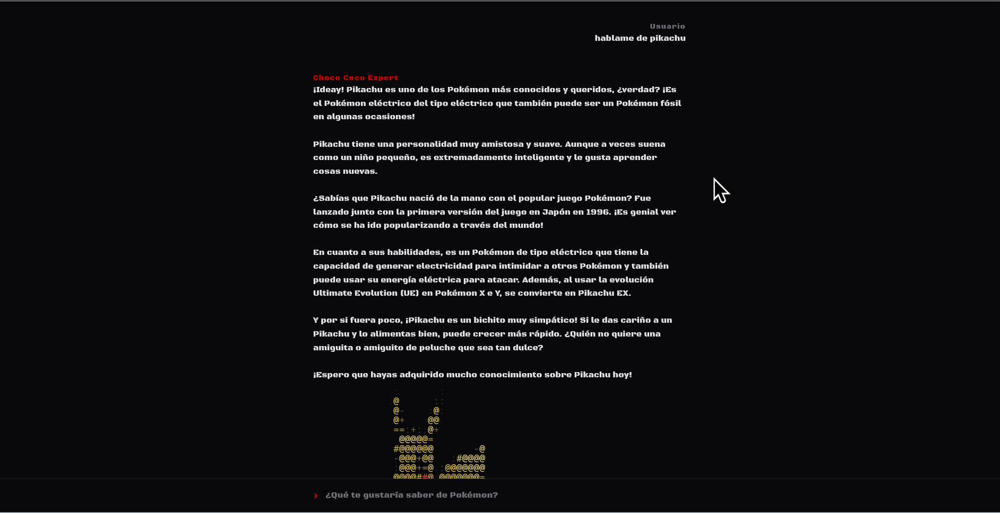

# Choco coco

A Pokémon expert system concept, powered by LLM and RAG (LLamaIndex).

Final project for the "Fundamentos de Sistemas Expertos" class.

See the [docs](./slides/choco-coco/conquito.md).



## Run the project

### Server

1. Clone the project

```sh
  git clone https://github.com/osmarmora05/choco-coco
  cd choco-coco
```

2. Create the `.env` file

```sh
  cat .env.example > .env
```

3. Run ollama, API, and tunnel (optional).

```sh
  docker compose up
```
